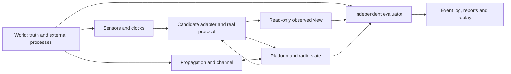

# 11. Simulation model and simulator design

**2026-10-31. Design target, not an implementation report.** The owner has allowed time to build
a good model before choosing a protocol. The target is a reusable, validated simulator of moving
groups, their devices and their shared radio environment. Getting a first relay comparison is a
milestone, not the definition of completion.

[10](10-protocol-comparison.md) defines capabilities, candidates and comparison rules. This
document defines the simulator that will support that work. It incorporates the independent
design reviews and the subsequent checks; it does not accept every proposed radio threshold or
fix the next air format. The executable baseline remains commit `9eb7725`: a 1 ms stepped C
simulation, current-v3 only, with the limitations documented in 10. Everything below is planned
unless explicitly described as existing.

**Implementation progress:** [`tools/simulate.py`](../tools/simulate.py) now composes a standard-library
Python DES with a small ABI around the actual C node/codec. Implemented parts include causal event
phases/delta cycles, world and clock models, directed/power channels, local radio state, interval
reception, exact time-weighted age/XY-error evaluation, research C forwarding and local-CAD
policies, seeded local/global burst processes, named radio-model sensitivity runs and offline replay. See the
[implementation notes](../tools/simulator/README.md) for exact supported behaviour and commands.
The complete target below is not yet achieved: calibrated RF/terrain, actual alternative upstream
firmware adapters and phone integration remain distinct work.

The current executable catalogue includes dense and neighbouring groups, a chain, a changing
bridge, a fork, coordinate/time outages, hidden terminals, local burst interference and sequential
contacts without a simultaneous path. Storage-order and reversed same-time-event probes compare
normalized transmissions/applied records. This is implementation evidence for these cases, not
calibration or proof that the entire design target is complete.

## Purpose and completion

The simulator must support these decisions:

- Which access and forwarding policies give useful positions and state updates to the leader
  and to a participant catching up?
- How do roster size, packet size, protection, PHY and clock uncertainty change feasible cadence
  and every board's air use?
- What happens in dense groups, chains, changing bridges, temporary partitions, short contacts
  and neighbouring independent groups?
- Which conclusions survive uncertain channel assumptions, and which physical measurements
  would distinguish alternatives?

It must execute the candidate's real portable logic and codec, or identify a reconstruction as
such. The environment must neither repair a protocol's missing information nor give it global
knowledge. Model fidelity is separate from agreement with a particular implementation.

A completed research simulator has executable contracts for its claimed mechanisms, controlled
examples with independently known outcomes, reproducible runs, convergence checks, useful
comparisons across the scenario catalogue, and a calibration path. Its reports identify unknown
parameters and unsupported mechanisms. Physical claims additionally require held-out hardware
observations; a simulation pass alone does not establish range or board readiness.

## Architecture and ownership

| Part | Owns | Must not do |
|---|---|---|
| World | True time, identities, trajectories, human actions, external signal sources | Choose which records a candidate forwards |
| Sensors and clocks | Measurements, delays, validity, local tick rates and resolution | Correct a candidate's UTC estimate using hidden truth |
| Propagation/channel | Received power and noise at each receiver over time | Drop a physical signal because its group key is wrong |
| Radio/platform | Mode changes, acquisition, reception, CAD/CCA, TX and IRQ timing | Expose a global busy flag as a perfect local sensor |
| Candidate | Its actual node logic, codec, queues, local observations and actions | Read future conditions, other nodes' state or evaluator identifiers |
| Evaluator | Provenance, ground truth, metrics and contract violations | Feed its conclusions back into the candidate |
| Replay/report | Presentation of recorded events and comparisons | Recompute a different stochastic world during playback |

Use one engine and environment for candidates. Keep the baseline adapter narrow, but define the
observation and action boundary before adding protocol-dependent branches to the world. A C
interface may wrap portable C or C++ implementations; no runtime plugin loader is required.
Candidate source revision, build, changes and unsupported behaviours accompany each result.

## Time and event execution

The target engine is discrete-event simulation. Use signed 64-bit relative **nanoseconds** for
world events, with explicit conversion to the existing core's microsecond clocks. This is a
representation choice, not a claim of nanosecond physical accuracy. Keep the UTC origin separate
from elapsed time; validate arithmetic ranges and declare rounding at every interface.

Trajectories and clocks are functions of true time. A clock can use
`local(t) = offset + integral(rate(t))`, followed by its resolution and monotonicity rules.
Constant or piecewise drift does not need a global polling tick. The engine converts a local
deadline to the earliest representable world event at which it is due. Later clock-rate changes
invalidate and reschedule affected deadlines. GNSS changes the candidate's time estimate, not
the hidden physical clock mapping.

Event classes include world actions, trajectory boundaries, sensor production and delivery,
PPS edges, node deadlines, mode application, RF start/end, receiver acquisition/header completion,
CAD/CCA completion, channel changes and observations for reports or transport.

At time `t`, use a documented causal sequence:

1. Close all affected histories on `[previous, t)` using their old states.
2. Complete RX, TX, CAD and other operations ending at `t` from those histories.
3. Apply scheduled world changes and completed platform/radio transitions.
4. Deliver local observations and collect ready node decisions against a consistent snapshot.
5. Commit new radio commands and RF starts as a batch for `[t, next)`.

Same-time CAD completions cannot let the first processed node reserve the channel for free.
An interference source starting at a packet's end cannot damage that completed packet. Multiple
changes at one timestamp update all affected receivers consistently. Zero-delay software
bookkeeping is allowed; physical delays are explicit parameters, not arbitrary epsilon fixes.
Detect zero-time event loops rather than silently advancing time.

Queued deadlines and callbacks carry an owner and operation/boot generation. Cancellation or a
restart invalidates stale software events; an old IRQ cannot complete a new boot's operation.
Physical RF termination follows the explicit platform model rather than disappearing merely
because a software callback was cancelled.

DES permits scheduled periodic and adaptive channel updates. For known boundaries, schedule the
crossing directly. For numerical propagation, use declared error bounds and a maximum update
interval. Looking only at endpoints is insufficient: a narrow shadow can lie between them.
Refining the update policy must not redraw the random environment.

Retain the current stepped engine as a migration reference. First compare a DES compatibility
mode with the same quantization and assumptions. Compare normalized transmissions, applied
records and final states, not incidental log order. Then enable finer timing. Explain changed
boundary outcomes with independent interval cases; do not require all receptions to remain
identical after changing the timing model.

## World, groups and movement

Keep `node_id`, `participant_id`, `group_id`, boot identity and slot assignment distinct. Two
groups may reuse a slot number. Physical separation does not change a roster. Roles such as
leader and catching-up participant belong to the scenario/evaluator and confer no extra knowledge.

The reference group sizes are 5, 10, 20 and 32, subject to candidate capacity. World capacity is a
separate explicit resource limit and must allow multiple such groups. A refused candidate setup
is reported as unsupported, not silently replaced with a smaller roster or a different cadence.

Use metric local coordinates `x, y, z`, with a declared origin and altitude convention.
Convert geographic inputs at a defined boundary; the GNSS model supplies latitude/longitude.
Routes are graphs of polylines with branches. A trajectory consists of time, route edge and
distance-along-edge keyframes with declared interpolation. It can represent stops, slow climbs,
overtakes, turning back, choosing a wrong branch, regrouping and changing the bridge participant.
Reject impossible discontinuities unless explicitly marked as input jumps.

Activity descriptions change movement, spacing and contacts; they do not redefine packet states
or freshness. No last-known zero speed proves that a participant remains stopped. Keep measured
coordinates and any future predicted display separate.

Support named channel inputs:

- **Scripted contact graph:** directed contact intervals independent of coordinates, for exact
  protocol experiments and hidden/exposed-terminal cases.
- **Scenario power map:** received power depends on time, node areas or pairs of route regions.
  Boundaries and optional transition ramps are explicit.
- **Coordinate-derived channel:** positions, antennas and a chosen propagation model determine
  power, with declared numerical approximation.
- **Recorded inputs:** trajectories and channel observations imported into the same schema,
  retaining gaps, timestamp quality and interpolation policy.

Declare how overlays compose. A node-area shadow may affect many links; a pair-of-areas shadow
may affect only paths between two parts of a column. Enumerate internal crossings as well as
entry/exit of the complete route segment. Do not implicitly mix a distance cutoff with scripted
contacts. DEM/terrain propagation is part of the target model catalogue, but needs a selected
method and validation data before it can support geographical predictions.

## Measurements, clocks and platform

Generate a sensor measurement from truth before delivering it to a device. Store separately:
measurement time, availability time, measured coordinates, error process and quantization.
Position validity, GNSS-time validity and PPS availability are independent controls. A tunnel
may suppress all corrections; a lost coordinate fix may leave time available.

Model measurement cadence, correlated position errors, outliers, serial delay, PPS/NMEA pairing,
missing messages and board clock resolution. Sensor quantization and the candidate codec's
quantization are separate. Per-node drift can depend on a scenario temperature history; the
candidate's assumed uncertainty may be correct or optimistic. Report the discrepancy.

Platform parameters include command/SPI delay, TX preparation, radio turnarounds, task/IRQ delay
and optional computation delays. Their sources and resolutions are explicit. Do not equate a
31 microsecond clock tick with interrupt accuracy. A board restart changes its local clock and
boot identity according to the scenario; its actual protocol decides what state survives.

Model observable radio behaviour rather than an SX1262 register emulator. Existing driver tests,
Android bench and real boards provide separate evidence for platform integration. The simulator
does not claim to run the full firmware merely because it executes the portable node core.

## Radio and propagation

### Physical signals

Create an immutable RF transmission descriptor at actual RF start. It contains the physical
sender, bytes/length, start/end, power, frequency, BW, SF, coding rate, preamble, header mode,
CRC, sync word, LDRO and every supported setting affecting that RF session. An implicit-header
receiver has its own expected parameters. Later MODE commands cannot alter an ongoing signal.
Take the snapshot from the radio's confirmed applied state, not the candidate's requested mode.

The descriptor specifies the emitted waveform and planned normal end. An abort or power loss is
a separate termination event, preserving the descriptor and closing the actual RF interval early.
Record actual occupied airtime separately from the protocol's booked cost and propagate the
truncation through receiver histories.

Derive airtime from this snapshot. Include every position, relay, retry, acknowledgement and
control packet in each board's cost. Larger packets occupy the sender's receiver for longer.
Foreign-group signals and undecodable transmissions remain potential interference; group-key
validation happens after physical reception.

CRC and authentication are separate. A no-CRC mode must define how corruption appears at its
interface or explicitly declare that aspect unsupported. Disabling CRC cannot turn corrupted
bytes into an automatically valid packet.

### Channel contract

The channel returns received power of each active signal and background noise at a selected
receiver over an interval. Propagation is separate from decoding: changing SF does not itself
change received RF power. Apply the selected spectral compatibility rules before aggregating
interference. Sum powers in linear units, not by averaging dBm.

The model catalogue includes:

| Model | Use and evidence boundary |
|---|---|
| Controlled graph | Exact logical contacts; optional distinct graphs for sensing, interference and decoding |
| Piecewise power | Unequal/asymmetric lines, local noise and known transitions without a terrain claim |
| Correlated shadow/fading | Explicit temporal/spatial and cross-receiver correlation; parameters swept until measured |
| Recorded channel | Reproduction of observed conditions, with observation gaps preserved |
| Terrain propagation | A named, versioned method applied to stated geographical inputs and antenna assumptions |

A controlled graph can use a symbolic channel/receiver contract that overrides sensing,
interference and decoding permissions without inventing RF power. Numeric RSSI/SNR then remain
unknown unless the scenario explicitly supplies synthetic values. A signal-dependent candidate
requires those declared observations or is unsupported in that mode; there is no silent fallback
to convenient signal levels. Identify symbolic and power-based results separately.

Independent per-packet erasures remain a useful named stress model. They are not a substitute
for a time-varying channel when comparing packet lengths. Periodic shared noise remains an
aliasing/adversarial case, not the only representative environment. Model global, receiver-local
and link-local degradation separately.

External interference is a reproducible process with location, power and timing. A neighbouring
reactive protocol is an actual set of nodes, not a prerecorded noise trace: its actions depend
on what it hears. Distinguish foreign LoRa packets, which may occupy acquisition, from other noise.

### Receiver and observable events

Represent at least sleep/off, RX search, acquisition, header, payload, CAD/CCA, TX preparation,
TX and return to RX. A receiver tracks the signal it has acquired. Define acquisition, loss of
lock and optional recapture explicitly; entering RX midway through a payload cannot produce
automatic success.

Distinguish three outcomes: a signal can interfere, be detected, or be decoded. CAD and energy
CCA have separate durations and detection models. Their output is local and may be wrong.
The time between detection and RF start permits another node to begin transmitting. Semtech's
[CAD application note](https://www.semtech.com/uploads/technology/LoRa/cad-ensuring-lora-packets.pdf)
describes the operation and this race; its example values are not calibration of our devices.

An active receive/CAD operation retains a history of desired signal, interferents, noise and
receiver state on half-open intervals. Every relevant RF start/end, power change, shadow crossing
or state transition closes the current interval. A packet on `[100,140)` must account for noise
on `[115,125)`, even when both endpoint conditions are good.

Keep reception models named and versioned: conservative overlap loss, a specified LoRaSim-inspired
capture model, an energy/interference model, and eventually measured variants. Their parameters
and applicable hardware/settings are explicit. They are alternative hypotheses, not proven
ordered bounds. See the [author's LoRaSim code](https://raw.githubusercontent.com/mcbor/lorasim/master/loraDir.py)
and [ns-3 LoRaWAN model](https://signetlabdei.github.io/lorawan/models/build/html/lorawan.html).
An energy ratio alone is not a validated FEC model. A single generic capture threshold is not
assumed to describe SX1262 across all settings.

## Candidate and observation boundary

The build-time adapter supplies these operations:

- Initialize a real node/codec with its configuration and private protocol randomness.
- Deliver typed local observations: sensor data, PPS, user commands, mode confirmation, received
  bytes and supported radio indications, with the appropriate local event/delivery timestamps.
- Return its next local deadline, or no scheduled action.
- Issue radio/platform commands: configure, sleep, listen, CAD/CCA, transmit actual bytes.
- Expose a read-only view of what its application would know, including unknown values.

Scheduling local deadlines does not give the node true world time. A failed or partially applied
radio configuration is observable as the adapter/platform contract specifies; requested and
confirmed settings stay distinct. Queue admission and eventual RF start are separate events.
Trace protocol intent and actual platform actions separately.

Adapters must not assume one packet equals one source update. A packet can carry several records;
one source measurement can appear in many packets. The v3 adapter must not keep assumptions such
as `source == RF sender == slot == rider table index` in the common evaluator.

Evaluator provenance uses a side channel. Distinguish participant, boot, coordinate measurement,
manual-state event, record creation and RF attempt. Instrumentation can track causal handles, but
these must not enter serialization, queue selection, duplicate suppression or other node decisions.
Removing instrumentation must leave protocol behaviour unchanged.

Matching by source and fix timestamp alone is insufficient. An old normal state and a newly
cancelled help state can have the same coordinates and contents. Where provenance cannot be
established, report unknown/ambiguous provenance or age bounds. Never choose the newest matching
truth record merely because it makes the result look fresh. Extra evaluator identities do not
automatically require extra wire fields; missing protocol information remains a candidate issue.

## Evaluation and comparison

### Time, coverage and correctness

Compute true coordinate age from world time and the original measurement. Compute the device's
reported age separately from its own calendar and decoded fields. Retain negative displayed
ages as clock anomalies. Unavailable or ambiguous provenance must not create a numeric true age.

Integrate distributions by duration between changes. True age grows linearly between updates;
displayed age may follow quantization, clock drift and calendar jumps. Preserve unknown portions
of time. Report conditional known-age distributions alongside the fraction of **all** pair-time
that has a known record with true age below each displayed threshold. No acceptance threshold
or aggregate winner score is invented.

For a known measurement made at `g` and held during `[l,r)`, its contribution to the duration
with true age at most `a` is `clamp(a - (l - g), 0, r - l)`. Sum those durations and divide by
known pair-time for the conditional CDF, or by all observed pair-time for the coverage-aware
curve. Quantiles come from this duration measure, not an unweighted list of receive events.

The fixed-phase 1 Hz baseline sample is not the target evaluator. A control integration of saved
`dense-10/ideal/17` observations gave p50 2.660307 s and p95 4.724953 s, against sampled 2.5 s
and 4.5 s. This is a check of the same ideal-clock trace, not a new protocol result or a measured
radio property. Keep old results identified by their evaluation version.

Separate gaps in radio reception, new source records and new coordinate measurements. A duplicate
can improve only the first. Mark gaps open at the beginning/end as censored bounds. Report per-pair,
per-role, per-group and worst-node results, not just pooled means.

For manual states, distinguish correct current view from proven delivery of a particular event.
Track superseded-before-delivery, expiry under the candidate's policy, not emitted, late arrival
and pending-at-end outcomes. Repeated equal content is not proof of a new event. Relay expiry
does not require deleting the last-known point from a map. Check stale overwrite, freshness
inflation, false direct-hearing evidence, source starvation, forwarding loops and budget violations.

The leader's results show unknown participants, worst ages and gaps, and arrival of a new stop
observation. The catching-up role measures whether a branch-distinguishing fix arrived before
the participant's decision point, plus time/distance margin and positional error. Truth-based
position error is an evaluator measure, never a reason to silently refresh an old displayed fix.

### Reachability and diagnostic references

Label instantaneous graph reachability as such. It is neither a delivery guarantee nor a bound
on store-and-forward over sequential contacts. Account for record creation time, contact order,
packet duration and any expiry policy when evaluating temporal reachability.

A diagnostic replay may propagate unlimited records across actual successful receptions. Label
it an optimistic, possibly unrealizable content bound for that candidate's trace. A physical
reference must specify packet sizes, contention, half-duplex and budgets. Unless optimality is
established, call it a reference strategy rather than an absolute oracle.
Even the unlimited-content replay preserves causality: snapshot records available to a sender
in causal event order at RF start and deliver that snapshot at RX end. A later arrival cannot
enter an already emitted packet; simultaneous completions do not create free multi-hop delivery
through transmissions that started earlier. Same-time availability follows the declared event
phases and preparation delays.

Do not subtract these references to claim a causal division into access loss and record-selection
loss. Their feasible sets may not be nested, and changing records changes airtime and future
receptions. Where age differences are meaningful, subtract true ages on the same known domain;
keep clock error and missing coverage separate.

### Experimental controls

Use independent namespaces for environment, protocol behaviour and group/layout generation.
Generate external processes per object and purpose; lazy evaluation is allowed if it is a pure
observation of a predetermined time/space field. No shared RNG consumption may make another
candidate's channel, sensors or clocks depend on traffic or iteration order.

Vary group keys/epochs, schedule phase relative to GNSS, event phase within frames, slot order
relative to road order, starts, contacts and noise. Treat node storage order as an invariance
check, not as an accidental source of randomness. Preserve environmental coupling between receivers
where the chosen model calls for it.

Run paired comparisons on identical world realizations. First hold source workload, environment
and declared per-node air budget fixed; then compare each candidate's feasible cadence. Count
all serialized traffic and the busiest board. Different PHYs require a declared common channel
model capable of representing their differences; changing only airtime does not compare range.
Report paired differences, variation across independent runs and ranking reversals across model
assumptions. Packets within one run are not independent repetitions.
Give uncertainty intervals based on independent world realizations, preserving paired comparisons.
Choose the number of runs by the precision needed to distinguish effects, not by treating three
seeds as sufficient. Keep tuning scenarios/seeds separate from held-out comparisons and retain
unsuccessful configurations; selecting favourable phases is not a protocol improvement.

## Scenario catalogue

Scenario values are experimental inputs, not field promises. Every case identifies the question,
observable outcome, required model capabilities and relevant role/pairs.

| Case | What it must expose |
|---|---|
| Dense groups, sizes 5/10/20/32 | Feasible setups, baseline freshness, duplicate/control cost and per-node budgets |
| Single bridge and bridge handover | Coverage of all sources, starvation, own-update displacement and recovery |
| Chains with forward/reverse/random slot order | Hop-age accumulation, scheduling dependence and expiry semantics |
| Branches and duplicate suppression | A suppressed copy must not silently cut off the receiver behind one branch |
| Sequential contacts with no instantaneous path | Store-and-forward benefit, contact ordering and stale-state handling |
| Short asymmetric encounters | Whole-packet fit, protocol setup overhead and dependence on return traffic |
| Leader sees a distant stop | New observation delay, unknown participants and distinction between link/fix age |
| Catching-up participant at a fork | Branch information received before the decision point, or explicitly unknown |
| Multiple independent groups | Mutual interference, group isolation, reactive traffic and fairness between groups |
| Hidden/exposed terminals | Local sensing versus interference/decoding, without global knowledge |
| Slow walking, stop and restart of movement | Speed-threshold mistakes, position-noise effects and honest last observations |
| Position loss versus time loss and return | Held fixes, time uncertainty, permitted access, silence and recovery |
| Cancel/repeat/reboot and relay cycles | Correct current state, event provenance, old-copy rejection and bounded forwarding |
| Local/global bursts and narrow shadow zones | Correlation, packet length effects and internal changes missed by endpoint checks |

Keep controlled counterexamples alongside broader generated scenes. Use scenario families and
targeted parameter sweeps rather than an unexplained Cartesian product of every option.

## Validation, calibration and evidence

Validation must target a plausible model error with an independently derived observable result.
Use the repository's [test-value procedure](../.agents/skills/test-value/SKILL.md); the table below
is a validation plan, not a claim that tests exist or pass.

| Check | Error it must detect |
|---|---|
| Single source/receiver with analytically known arrivals | Wrong delay, integrated AoI or unknown-time weighting |
| Noise strictly inside a packet and exact boundary coincidences | Endpoint-only reception checks and incorrect interval ownership |
| Simultaneous sensing and simultaneous starts | Artificial collision avoidance from node order |
| Permuted storage order and extra channel queries | Shared RNG consumption, mutating observation or unstable scheduling |
| Immutable TX settings during MODE; multiple interferents | Wrong airtime/PHY snapshot and incorrect power aggregation |
| Late RX entry, preamble acquisition and receiver busy states | Impossible successful reception or free instantaneous sensing |
| Lost coordinates versus lost time; optimistic clock error | Freshened held positions, broken holdover or unjustified timing claims |
| Equal-content state changes, reboot and stale copies | False proof of event delivery and source identity confusion |
| Known sequential-contact and expiry cases | Substitution of instantaneous BFS for temporal delivery |
| Finer time/space tolerances and finer stochastic-field sampling | Rankings caused by discretization rather than protocol behaviour |
| Baseline adapter and quantized-DES compatibility | Accidental semantic changes during extraction/migration |
| Actual codec length and independent airtime/budget accounting | Free payload, omitted control traffic or an overused bridge |

An analytical ALOHA check, if used, must instantiate its assumptions explicitly; its throughput
curve does not validate carrier sensing, LoRa capture or real propagation. Compatibility checks
compare normalized meaning within shared assumptions. Convergence means numerical error is
small relative to the candidate differences and input uncertainty; if ranking changes, report it
and investigate rather than declare a winner.

Every physical parameter has units, scope, model version and provenance: synthetic, literature
or measured, with a reference and conditions. Store confidence/ranges and numerical tolerances.
Literature-inspired capture and shadow parameters are not measurements of Heltec or L1.

Two boards can calibrate direct delivery, RSSI/SNR behaviour, clocks, CAD and switching/start
timings under recorded conditions. Competing transmissions into one receiver and a physical
relay test require three radios. Confirm absence of the direct path in a relay experiment.
Measure holdover by removing time corrections, not merely valid coordinates. Record antennas,
mounting, power, PHY, raw NMEA/PPS/DIO1 data and the measurement instrument's uncertainty.

Reserve observations not used for parameter fitting. Compare predictions with those held-out
observations, and retain mismatches as model limitations. Channel recordings observe a link
only when probed; gaps between packets do not prove a continuously good or bad channel.
Sensitivity sweeps remain necessary outside calibrated conditions.

## Logs, replay and presentation

Version the scenario schema, event schema, evaluator and all model implementations. Capture input
snapshots/hashes, component seeds, model parameters/provenance, trajectory frames/interpolation,
candidate builds and patches, configurations and numerical tolerances. Hash the exogenous world
manifest/realization separately from the endogenous transmission trace. Candidate-dependent radio
traffic must not make the expected world hash differ.

Keep truth, delivered sensor observations, platform/radio events, source provenance, candidate
views and decision reasons as distinguishable records. A compact run may retain summaries plus
selected traces; a failure must be reproducible in detailed mode without changing behaviour.
Unknown and unsupported values remain explicit in both machine and human reports.

Offline replay reads these events. It can show truth against the selected participant's known
positions, contacts, packet paths, failures, state changes and metrics. It does not rerun channel
randomness. Batch comparison works without a viewer. Real-time pacing for the Android bench
belongs outside the deterministic engine; phone/BLE/map observations remain a distinct evidence
level and are not synthesized from a C-node reception.

## Implementation sequence

These stages build the full target; none is a shortcut definition of a completed model.

| Stage | Concrete result | Completion evidence |
|---|---|---|
| 1. Truth and contracts | Stable world/source identities, event/parameter schemas, read-only candidate views, independent seeds, time-weighted true/displayed metrics | Analytical examples, provenance ambiguity cases, deterministic paired runs and baseline adapter checks |
| 2. DES and radio lifecycle | Event engine, local deadlines, platform delays, immutable signals, receiver state and interval histories, v3 adapter | Quantized compatibility, independent boundary cases, same-time order invariance and timing convergence |
| 3. World and channel models | Route graph, trajectories, GNSS errors, multiple groups, scripted/power/parametric channels, local and global interference | Scenario catalogue across activities/sizes, spatial/time convergence and explicit model assumptions |
| 4. Candidates and diagnostic references | Actual alternative codecs/access/forwarding logic, temporal diagnostics and paired reports | Full byte/air budgets, origin-preserving relays, model-sensitivity results and supported-capability accounting |
| 5. Calibration and replay | Hardware parameter sets with held-out validation, reproducible traces, offline visual replay and Android-bench integration | Explained model/measurement differences, repeatable case inspection and separate core/phone/hardware evidence |

Calibration preparations and small prototypes can run alongside earlier stages. Capture, sensing
and geographical models have their own readiness checks; they must not be labelled complete
because one relay scenario passes. Retain existing commands and input/report versioning during
migration. Do not silently reinterpret historical baseline numbers using the new evaluator.

Suggested code ownership follows the architecture: host-only engine, world/sensors, channel/radio,
candidate adapters, evaluator and CLI. Extract the existing simulator into such modules as the
implementation needs them; keep portable firmware logic shared. Use the existing build and
standard-library tooling where suitable. Reassess an external simulation library only against
concrete integration/validation work, not merely because the design uses DES.

## Decisions to resolve during implementation

- Exact acquisition/recapture, CAD detection and corruption interfaces supported by each radio
  model and candidate. Unsupported behaviour must be rejected or declared, never idealized silently.
- Parameterization and calibration of correlation, fast fading, antennas and terrain propagation.
- Numerical error budgets for adaptive boundaries and model-specific integration.
- Proof/ambiguity rules for provenance when a real format omits source versions or precision.
- The bounded physical reference strategy and any later optimization oracle.
- The practical adapter boundary for a pinned Meshtastic implementation versus a clearly named
  reconstruction, and which platform behaviour the result actually executes.

These are engineering/research questions, not additional owner approval gates. No final field
profile, protection mode, relay-release scope or freshness promise is selected by this document.
