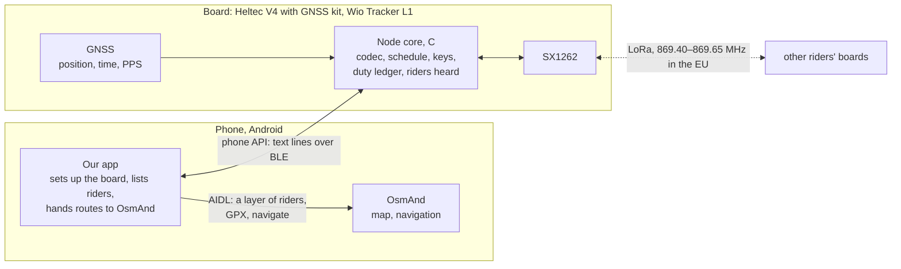
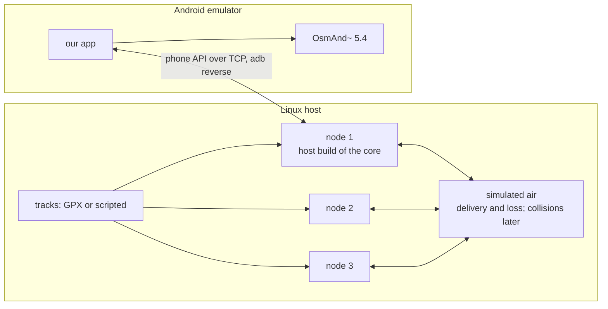

# Architecture

How the system is split, and the decisions behind it. Nothing here is stable: every interface
carries a version, and any of them may change in one commit together with both of its ends (D3).
Milestones are in [ROADMAP](ROADMAP.md), open questions in [BACKLOG](BACKLOG.md).

## The pieces

| | Board | Our app | OsmAnd |
|---|---|---|---|
| Own position and time | from its GNSS, with PPS where wired | later, for a board without GNSS | shows the phone's own |
| Packets: build, encrypt, check, decode | ✅ | | |
| When to transmit; duty ledger; power limits | ✅ | | |
| Group key, slot, radio mode | keeps them | sets them from an invitation | |
| Riders heard | keeps the table | makes map points with stale and help marks | draws them |
| Routes | carries changes over LoRa (later) | keeps files by hash, builds the GPX it hands over | imports, shows, navigates |

A board works without a phone: it sends its own position and keeps listening. A phone without a
board shows only its own position.

## Interfaces

| Interface | Between | Form | Its version |
|---|---|---|---|
| Air format | board and board | binary packets, [PROTOCOL](PROTOCOL.md) from M3 | two bits of the first byte |
| Phone API | board and app | text lines of `key=value` tokens: over BLE (Nordic UART Service), over TCP to a simulated board, over the USB console on the bench | `proto=` in the status line |
| Invitation | organiser and riders | one string, shown as a QR code or sent as a link (M5) | its prefix |
| OsmAnd | app and OsmAnd | AIDL V2 through `android-aidl-lib` 5.4 | OsmAnd's own; checked on connecting |

A side that meets a version it does not know refuses, and says so; it never guesses (D3).

## Testing without hardware

The owner has no bench for now, so every milestone has a test that needs no boards (D8):

| Level | What it checks | From |
|---|---|---|
| Host C tests | the codec, the NMEA reader, the duty ledger, the schedule: one core alone | M3 |
| Simulator | several cores on simulated air, in virtual time | M3 |
| JVM tests | the app's logic without Android | M1 |
| Emulator | riders and routes in a real OsmAnd; later the app against simulated boards | M1 |
| Hardware | boards on a bench, then on the road | waits for the bench |

`make check` runs the host, simulator and JVM levels; `android/emulator.sh` sets up the emulator.

## Decisions

Each says what was decided, why, and what it costs. A decision changes by editing it here, with
the date.

### D1. Our own protocol (2026-10-22)

We build the protocol of [06](06-own-protocol.md): scheduled slots by GPS time, each rider sending
only its own position, relaying separate and selective. Tuned Meshtastic stays the baseline it has to
beat (E6 in [07](07-experiments.md)), not a part of it.

- **Cost:** firmware on every board we support, and no interoperability with plain Meshtastic
  radios in the first versions (question 4 in [01](01-goals.md)).
- **Still open:** questions 1 and 2 in [01](01-goals.md), group size and freshness. They no
  longer decide the direction, but they set the default radio mode (M5).

### D2. One repository

The research notes, the protocol, the firmware, the app and the tools live here. A change to the
air format or to the phone API lands in one commit with both ends and their tests. Separate
repositories would need versioned releases and compatibility between them, which nothing needs yet.

### D3. Every interface is versioned; none is stable

Each interface in the table above carries a version number, and a side that sees one it does not
know refuses it. There is no code for old versions before 1.0: old boards are reflashed, old apps
reinstalled.

### D4. The board is the node; the phone shows and sets up

The board owns everything the protocol needs: its position and time from its GNSS, the group key,
building and checking packets, when to transmit, the duty ledger, the riders heard. The phone sets
the board up, shows the riders in OsmAnd, and later carries routes and the hub.

- **Why:** a board must work alone, as a beacon ([01](01-goals.md), wishes), and the schedule needs
  the GNSS's time on the board itself ([06](06-own-protocol.md), Timing). This moves dmd2-lora-bridge's
  boundary, where the codec lived on the phone, by the bridge's own rule: the codec lives with
  whatever owns the position and the transmit schedule.
- **So:** one codec, in C, on the board. The app gets riders already decoded, so it knows nothing of
  the air format and could later show riders from another kind of radio.
- **Cost:** the group key lives on the board, and a lost board can read and forge positions until
  the key changes ([06](06-own-protocol.md), security rules); a codec fix needs a reflash, which host
  tests and the simulator make rare.

### D5. Boards with GNSS first

- **Heltec WiFi LoRa 32 V4** (ESP32-S3) with Heltec's GNSS expansion kit: an L76K on a UART, PPS on
  GPIO 41.
- **Seeed Wio Tracker L1** (nRF52840): an L76K on a UART; its pin map has no PPS.

[code: Meshtastic `variants/esp32s3/heltec_v4`, `variants/nrf52840/seeed_wio_tracker_L1` at
`fad52bb`; Zephyr's `wio_tracker_l1` board]. The toolchains are dmd2-lora-bridge's: ESP-IDF through
PlatformIO `espressif32@7.1.2`, and Zephyr 4.5.0-rc1 for the nRF52840. EBYTE modules are out
([06](06-own-protocol.md)); other boards wait (T-boards, T-phone-gps).

### D6. dmd2-lora-bridge is copied, not depended on

The code we take comes from dmd2-lora-bridge at `2234b5a` (Apache-2.0, the same owner):

- **firmware:** the platform layer (`port.h`, ESP-IDF and Zephyr), BLE with bonding and one owner,
  the SX1262 backend, the LED, the watchdog, host tests on plain gcc;
- **app:** the BLE link, the foreground service, the health and battery checks.

Left behind: the EBYTE backends, DMD2's side of the app, the DMD codec and its base64 framing. The
bridge stays as it is, a record of the DMD work.

### D7. The node core is pure C

The core reads no clock and does no I/O, and has no threads. The platform hands it timestamped
events, such as a fix, a packet received, a line from the phone or a tick, and carries out what it
asks for: transmit at a given time, send a line to the phone. The same core then runs on ESP-IDF,
on Zephyr and on the host, where tests and the simulator drive it in virtual time, the same way on
every run.

### D8. Tested without hardware first

Each milestone has a test that runs without boards, and a test on hardware written down beside it
(table above). A milestone is "done, no hardware" when the first passes, and "done" when the second
does. Hardware tests wait for the owner's bench; nothing is ridden on the strength of the
simulator alone.

### D9. The phone API is text lines

As in dmd2-lora-bridge: lines of `key=value` tokens over a byte stream, the same on BLE, TCP and
the USB console, readable in a log and typed by hand on the bench. Binary only if text measurably
falls short.

### D10. OsmAnd through its AIDL API, with code of our own

The app uses OsmAnd's AIDL V2 API through `android-aidl-lib` 5.4 from OsmAnd's own repository,
vendored and pinned (SHA-256 `9f5419af…`, the same file MeshAnd vendors). MeshAnd is read, not
copied, so the licence stays the owner's choice (T-licence). On OsmAnd 5.4 the rider enables our
app once, in Plugins; OsmAnd's `develop` adds permission groups and a dialog that asks for them
([05](05-osmand-integration.md)).

### D11. Protocol v0 is for the bench

Plaintext, random access, one radio mode: enough for boards to hear each other (M3). Nothing is
ridden before M5 adds authenticated encryption.
