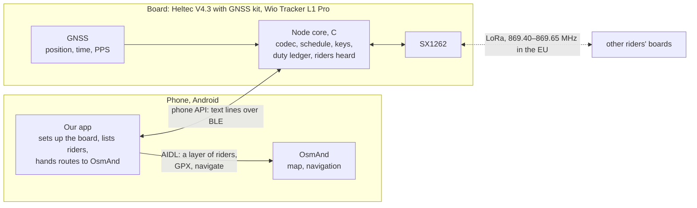
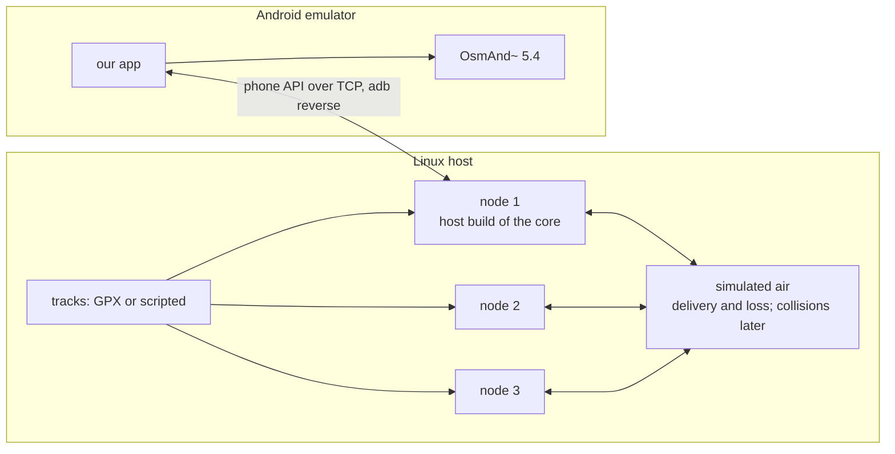

# Architecture

How the system is split, and the decisions behind it. Nothing here is stable: every interface
carries a version, and any of them may change in one commit together with both of its ends (D3).
Milestones are in [ROADMAP](ROADMAP.md), open questions in [BACKLOG](BACKLOG.md).

## The pieces

| | Board | Our app | OsmAnd |
|---|---|---|---|
| Own position and time | from its GNSS, with PPS where wired | later, for a board without GNSS | shows the phone's own |
| Packets: build, encrypt, check, decode | ✅ | | |
| When to transmit; duty ledger; power limits | ✅ | | |
| Group key, slot, radio mode | keeps them | sets them from an invitation | |
| Riders heard | keeps the table | makes map points with stale and help marks | draws them |
| Routes | carries changes over LoRa (later) | keeps files by hash, builds the GPX it hands over | imports, shows, navigates |

A board works without a phone: it sends its own position and keeps listening. A phone without a
board shows only its own position.

## Interfaces

| Interface | Between | Form | Its version |
|---|---|---|---|
| Air format | board and board | binary packets, [PROTOCOL](PROTOCOL.md) from M3 | two bits of the first byte |
| Phone API | board and app | text lines of `key=value` tokens: over BLE (Nordic UART Service), over TCP to a simulated board, over the USB console on the bench | `proto=` in the status line |
| Invitation | organiser and riders | one string per rider, `LC2.` and base64url, with the riders' names, sent as text ([PROTOCOL](PROTOCOL.md)); a QR code later (T-invite) | its prefix |
| OsmAnd | app and OsmAnd | AIDL V2 through `android-aidl-lib` 5.4 | OsmAnd's own; checked on connecting |

A side that meets a version it does not know refuses, and says so; it never guesses (D3).

## Testing without hardware

The owner has no bench for now, so every milestone has a test that needs no boards (D8):

| Level | What it checks | From |
|---|---|---|
| Host C tests | the codec, the NMEA reader, the duty ledger, the schedule: one core alone | M3 |
| Simulator | several cores on simulated air, in virtual time | M3 |
| JVM tests | the app's logic without Android | M1 |
| Emulator | riders and routes in a real OsmAnd; later the app against simulated boards | M1 |
| Hardware | boards on a bench, then on the road | waits for the bench |

`make check` runs the host, simulator and JVM levels; `android/emulator.sh` sets up the emulator.

## Decisions

Each says what was decided, why, and what it costs. A decision changes by editing it here, with
the date.

### D1. Our own protocol (2026-10-22)

We build the protocol of [06](06-own-protocol.md): scheduled slots by GPS time, each rider sending
only its own position, relaying separate and selective. Tuned Meshtastic stays the baseline it has to
beat (E6 in [07](07-experiments.md)), not a part of it.

- **Cost:** firmware on every board we support, and no interoperability with plain Meshtastic
  radios in the first versions (question 4 in [01](01-goals.md)).
- **Settled since:** group size and freshness (2026-10-24): a setup computed for each group, and
  freshness measured on setups the radio can achieve rather than fixed by guess (D18).

### D2. One repository

The research notes, the protocol, the firmware, the app and the tools live here. A change to the
air format or to the phone API lands in one commit with both ends and their tests. Separate
repositories would need versioned releases and compatibility between them, which nothing needs yet.

### D3. Every interface is versioned; none is stable

Each interface in the table above carries a version number, and a side that sees one it does not
know refuses it. There is no code for old versions before 1.0: old boards are reflashed, old apps
reinstalled.

### D4. The board is the node; the phone shows and sets up

The board owns everything the protocol needs: its position and time from its GNSS, the group key,
building and checking packets, when to transmit, the duty ledger, the riders heard. The phone sets
the board up, shows the riders in OsmAnd, and later carries routes and the hub.

- **Why:** a board must work alone, as a beacon ([01](01-goals.md), wishes), and the schedule needs
  the GNSS's time on the board itself ([06](06-own-protocol.md), Timing). This moves dmd2-lora-bridge's
  boundary, where the codec lived on the phone, by the bridge's own rule: the codec lives with
  whatever owns the position and the transmit schedule.
- **So:** one codec, in C, on the board. The app gets riders already decoded, so it knows nothing of
  the air format and could later show riders from another kind of radio.
- **Cost:** the group key lives on the board, and a lost board can read and forge positions until
  the key changes ([06](06-own-protocol.md), security rules); a codec fix needs a reflash, which host
  tests and the simulator make rare.

### D5. Boards with GNSS first

- **Heltec WiFi LoRa 32 V4.3** (ESP32-S3) with Heltec's own GNSS kit: an L76K on a UART, PPS on
  GPIO 41.
- **Seeed Wio Tracker L1 Pro** (nRF52840): an L76K on a UART; its pin map has no PPS.

These are the owner's boards, the ones dmd2-lora-bridge was built on; neither GNSS has run yet.

[code: Meshtastic `variants/esp32s3/heltec_v4`, `variants/nrf52840/seeed_wio_tracker_L1` at
`fad52bb`; Zephyr's `wio_tracker_l1` board]. The toolchains are dmd2-lora-bridge's: ESP-IDF through
PlatformIO `espressif32@7.1.2`, and Zephyr 4.5.0-rc1 for the nRF52840. EBYTE modules are out
([06](06-own-protocol.md)); other boards wait (T-boards, T-phone-gps).

### D6. dmd2-lora-bridge is copied, not depended on

The code we take comes from dmd2-lora-bridge at `2234b5a` (Apache-2.0, the same owner):

- **firmware:** the platform layer (`port.h`, ESP-IDF and Zephyr), BLE with bonding and one owner,
  the SX1262 backend, the LED, the watchdog, host tests on plain gcc;
- **app:** the BLE link, the foreground service, the health and battery checks.

Left behind: the EBYTE backends, DMD2's side of the app, the DMD codec and its base64 framing. The
bridge stays as it is, a record of the DMD work.

### D7. The node core is pure C

The core reads no clock and does no I/O, and has no threads. The platform hands it timestamped
events, such as a fix, a packet received, a line from the phone or a tick, and carries out what it
asks for: transmit at a given time, send a line to the phone. The same core then runs on ESP-IDF,
on Zephyr and on the host, where tests and the simulator drive it in virtual time, the same way on
every run.

### D8. Tested without hardware first

Each milestone has a test that runs without boards, and a test on hardware written down beside it
(table above). A milestone is "done, no hardware" when the first passes, and "done" when the second
does. Hardware tests wait for the owner's bench; nothing is ridden on the strength of the
simulator alone.

### D9. The phone API is text lines

As in dmd2-lora-bridge: lines of `key=value` tokens over a byte stream, the same on BLE, TCP and
the USB console, readable in a log and typed by hand on the bench. Binary only if text measurably
falls short.

### D10. OsmAnd through its AIDL API, with code of our own

The app uses OsmAnd's AIDL V2 API through `android-aidl-lib` 5.4 from OsmAnd's own repository,
vendored and pinned (SHA-256 `9f5419af…`, the same file MeshAnd vendors). MeshAnd is read, not
copied, so the licence stays the owner's choice (T-licence). On OsmAnd 5.4 the rider enables our
app once, in Plugins; OsmAnd's `develop` adds permission groups and a dialog that asks for them
([05](05-osmand-integration.md)).

### D11. Protocol v0 is for the bench

Plaintext, random access, one radio mode: enough for boards to hear each other (M3). Nothing is
ridden before M5 adds authenticated encryption. v1 did (2026-10-22), and v0 is gone.

### D12. Android 12 and later (2026-10-22)

One Bluetooth permission model, without location permission for scanning, as in dmd2-lora-bridge.

### D13. AES-128-CCM of our own (2026-10-22)

The firmware carries its own AES-128 and CCM (`firmware/src/crypto.c`, under 150 lines), checked
against FIPS-197, RFC 3610 and OpenSSL, and the app derives the group tag with Java's AES.

- **Why:** one implementation on ESP-IDF, on Zephyr and on the host (D7), so the host tests and
  the simulator run the very code the boards do. mbedTLS on ESP-IDF and Zephyr's crypto API differ,
  and neither runs in the host tests. A packet every 2 s needs microseconds of AES, so the chips'
  AES hardware is not worth a backend each.
- **Cost:** cryptography without an outside review. The tag check takes constant time and a failed
  check wipes the plaintext, but AES looks its S-box up in a table, whose timing depends on the key
  where caches are involved; over the air the timing is buried under the random interval, and
  nobody else's code runs on a board. A review before the first ride is part of T-tag and T-nonce.

### D14. GPL-3.0-or-later (2026-10-23)

The whole repository: firmware, app, tools and documents.

- **Why:** the app ships OsmAnd's `android-aidl-lib`, built from OsmAnd's repository, whose code is
  GPLv3 with no exception for that module [code: `LICENSE` at `a68b83f`]; and GPL keeps MeshAnd's
  and Meshtastic's code open to us. The code taken from dmd2-lora-bridge (Apache-2.0) is the same
  owner's.
- **Cost:** nobody can build a closed product on this firmware or protocol code; the protocol
  itself, as documented, stays free to implement.

### D15. The mode in use is the mode applied (2026-10-24)

The schedule and the duty ledger reckon with the radio mode the radio has taken, never one only
asked for; a board sends nothing between a new mode asked and the radio confirming it.

- **Why:** `MODE` changed the core's mode at once, while the radio task sent one more packet on the
  old one: after SF11/250 to SF7/250 the core booked 31 ms for a packet of 370.688 ms, which at ten
  riders, slots 181.818 ms apart, runs over the next slots ([09](09-protocol-next.md)).
- **So:** the core keeps the mode it was told and the mode the radio confirmed, and sends only when
  they are one. A group's profile, once it carries the mode, is applied the same way.
- **Cost:** a slot or two of silence at each change of mode.

### D16. A time keeps its meaning to the phone (2026-10-24)

The time of an event, a fix, a packet heard, an answer to a call for help, reaches the app as a
time, not as an age reckoned when the line was made: a line waits in queues and on the air, and
its ages would come out younger by that wait.

- **Why:** a position 29 s old that reached the app 5 s later was shown 29 s old, and fresh; and a
  caller's board hears an answer within a second, while its phone learnt of it with the next
  status, up to 10 s on ([09](09-protocol-next.md)).
- **So:** the board's lines say when they were made, on its UTC, and the app reckons the board's
  clock against its own from the lines that came quickest; a change in who answers our call is
  told at once.
- **Cost:** a token more in each line, and ages on the phone as good as that reckoning.

### D17. One participant's state for every activity (2026-10-24)

The boards are for motorcyclists, cyclists, hikers and mixed groups, and a code means the same for
all of them. A packet carries the facts its board observes, any of them at once: a current
position, stopped, battery low; and one state its rider chooses: normal, need help, please stop
(a request to the group, where stopped is a fact), need fuel, helping. The chosen state is said
again in every packet until it is changed or called off; the app offers the buttons that fit an
activity.

- **No automatic answers.** No board answers a call for help by itself: there is no call number to
  match answers by, and no list of those who answered. Helping names no one, and the app never
  claims from it that help is on its way to a given rider; with several calls at once, who helps
  whom is unknown, and that is accepted. An addressee comes back if rides show a need for one.
- **After a restart or a loss of power** the chosen state is normal again, need help included.
- **On the board itself**, no button for help in the first iteration; a screen and a button to
  choose a state on some boards is a later task (T-board-ui).
- **Why:** a radio that received a call says nothing of a person's answer to it, and a state said
  again in every packet needs no bookkeeping of its own.
- **So:** v3's byte of answers stays in v4, reserved and sent as zero. The facts and the chosen
  state may share one byte, but no bit and no layout is fixed yet ([09](09-protocol-next.md)).
- **Cost:** a caller learns of no delivery: the app shows that the state is going out and how
  fresh each rider's radio contact is instead. A call cut short by a restart must be made again.

### D18. A group's setup is computed when the group is made (2026-10-24)

The organiser sets the roster. The app computes the interval, the schedule and the radio mode from
the number of slots, the packet's size and airtime, the clocks' error and the radio's limits; every
rider's board gets that one setup, and a setup that does not fit is refused. Nothing changes the
roster or the schedule on the move.

- **Ten riders** are the first iteration's reference, not a technical maximum: a larger group gets
  a longer interval, never a schedule that breaks.
- **Freshness** is not a number guessed in advance. Setups the radio can achieve are proposed and
  measured, each by three different measures: the interval between sendings, the age of the
  position on the map, and the longest gap between successful updates. Profiles are fixed only
  after measuring on the boards ([09](09-protocol-next.md)).
- **Why:** slots keep apart only if every board of a group runs one setup, and a setup checked
  whole cannot leave a board silent, as one too tight for its time error does now.
- **Cost:** a change of roster or mode is a new setup, made at a regroup (T-join).

### D19. A board without GNSS keeps its last position and its own slot (2026-10-24)

A fix lost is not time lost. A board keeps its last reliable position and when it was taken, and
its last speed and stop go out as the last observation. It sends only in its own slot, and only
while its time's error fits the slot's margin; past that it stops sending and listens. Losing GNSS
starts no random sending and no extra retries.

- **In the app** three things stay apart: how fresh the radio contact is, how old the position is,
  and what movement or stop was last observed. "Heard 2 s ago; position a minute old; stopped at
  the last fix" says nothing of whether the rider stands now. No new field is needed for it.
- **v4** may send a rider's state without a position, before the first fix too, if the board's
  time is good enough for its slot (D17).
- **Why:** a tunnel or a forest takes the fix and leaves the clock running, and a board that
  guessed at its slot would take a neighbour's.
- **Cost:** a long outage silences a board that still has its last position to tell. How long its
  time holds comes from measurements, not from an assumption (T-timing, T-clock-drift).

### D20. What is measured stays apart from what is drawn (2026-10-24)

An animation or a prediction on the map never changes a fix's time, never makes a position fresh,
and never changes a rider's observed facts. A prediction from speed and course, if one comes, has
a bounded horizon and looks unlike a measured position.

- **Why:** at a fork a prediction may show the wrong road, which is the very turn a rider catching
  up watches for.
- **Cost:** the map moves a fix at a time until a prediction is built (T-predict); nothing is added
  to the format for it now.
