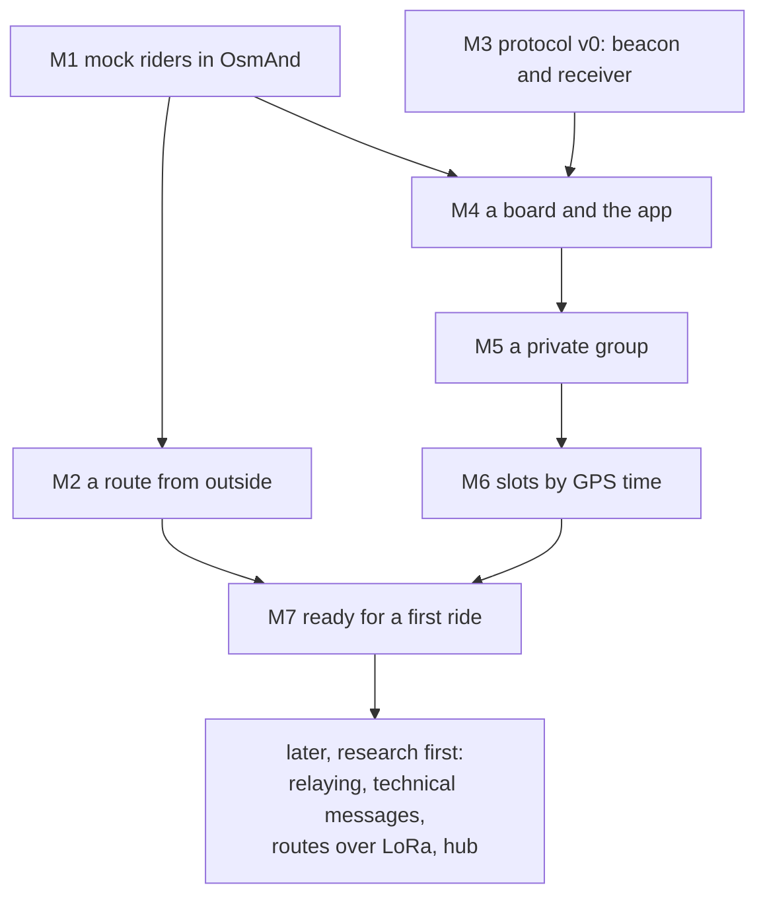

# Roadmap

Milestones in the order we build them. Each has a test that runs now, without boards, and a test
on hardware that waits for the owner's bench ([ARCHITECTURE](ARCHITECTURE.md), D8). Where a
decision is still open, the milestone names the ticket in [BACKLOG](BACKLOG.md) that settles it;
any ticket can become a GitHub issue as it stands.

Nothing is stable yet: a milestone may change the air format, the phone API or both, together with
everything that uses them (D3).

**Status:** planned · in progress · done, no hardware (its tests without boards pass) · done (its
hardware test passed too).

| | Milestone | App | Firmware | Status |
|---|---|---|---|---|
| M1 | Mock riders on the OsmAnd map | ✅ | | done, no hardware |
| M2 | A route from outside | ✅ | | done, no hardware |
| M3 | Protocol v0: a beacon and a receiver | | ✅ | done, no hardware |
| M4 | A board and the app | ✅ | ✅ | done, no hardware |
| M5 | A private group: invitation and encryption | ✅ | ✅ | done, no hardware |
| M6 | Slots by GPS time | ✅ | ✅ | done, no hardware |
| M7 | Ready for a first ride | ✅ | ✅ | in progress |

## M1. Mock riders on the OsmAnd map

The map side first: it is the same whatever the radio ([05](05-osmand-integration.md)), and it can
be finished on an emulator.

- An app of our own in `android/`, on dmd2-lora-bridge's build setup.
- It connects to OsmAnd's AIDL service (OsmAnd, OsmAnd+ or OsmAnd~), notices when OsmAnd is
  missing or has not enabled us yet, and tells the rider where to enable it (on 5.4: Plugins).
- A mock source stands in for the board: three riders moving around a point, one of them going
  stale and one asking for help.
- One map layer, one point per rider: name and colour on the point; fix age, link age, speed and
  status in its details. Stale and help show on the point itself.
- Tapping a rider opens OsmAnd's menu with the details; its own NAVIGATION button routes to the
  rider.

**Test now:** JVM tests for the mock source and for turning a rider into a point. On the emulator,
with OsmAnd~ 5.4.10 from F-Droid: the riders appear and move, a tap shows the details, and
NAVIGATION routes to the rider. `android/emulator.sh` sets the emulator up, so the run repeats.
**Test on a device:** the same on the owner's phone, on OsmAnd's default engine.

**Result, 2026-10-22, on the emulator:** OsmAnd refused the app until it was switched on in
Plugins, and the app said where. Then three riders circled the map's centre: B turned red with
"B SOS", C went grey with its silence on the label, the details gave the times heard and of the
fix, and NAVIGATION routed 421 m to B on the Liechtenstein map. On OsmAnd's OpenGL engine, its
default, the riders blink at every update; on its Version 1 engine they do not (T-osmand-opengl).

## M2. A route from outside

Where a route from LoRa or from the hub will end up, tested before either exists.

- The app takes a GPX from outside: Android's share and "open with", which adb can drive too.
- It keeps the file under its SHA-256, the address a route will have over LoRa and on the hub
  ([06](06-own-protocol.md), Geometry and intent).
- It hands the file to OsmAnd: shown with `importGpx` and `showGpx`, navigated with `navigateGpx`
  only once the rider accepts, and never snapped to roads by default.
- "Received", "imported" and "navigating" stay separate states: OsmAnd's success only means a
  request was accepted ([05](05-osmand-integration.md)).

**Test now:** JVM tests for reading a GPX (and refusing what is not one, external entities
included) and for the hash. On the emulator: a GPX pushed with adb and opened with the app shows in
OsmAnd, and navigation starts once accepted.
**Test on a device:** a route shared from a messenger or a file manager. A share cannot be tested
from adb: `am start` grants the app only the intent's data, and a share grants its stream.

**Result, 2026-10-22, on the emulator:** `android/emulator.sh route` opened a 3.2 km test route
with the app; "Show in OsmAnd" put it among OsmAnd's tracks and on the map, and "Navigate along it"
started OsmAnd's navigation along it. A KML was refused as not a GPX. OsmAnd's library crashed the
app on the first try: it needs `passWholeRoute` set ([05](05-osmand-integration.md)).

Reversing a route and cutting it to a day's segment are T-route-intent.

## M3. Protocol v0: a beacon and a receiver

The first firmware: each board sends its own GNSS position and lists what it hears. Bench only,
since v0 is plaintext (D11).

- **[PROTOCOL](PROTOCOL.md) v0:**
  - the packet sketch of [06](06-own-protocol.md) without its tag, about 17 bytes;
  - one radio mode, SF7/250 at 869.525 MHz, with a sync word of our own; other modes are a line
    each until T-phy sets the defaults;
  - random access: a position every few seconds with jitter, and only with a fix;
  - the duty cycle enforced on the board, 10 % an hour.
- **The node core** (D7): the codec, the beacon's timing, the table of riders heard, the duty
  ledger.
- **GNSS:** one NMEA reader of our own for both boards (RMC and GGA: position, speed, course, time,
  fix quality) and the L76K's power pins. Zephyr's own GNSS driver stays unused, so both boards
  share one path.
- **From the bridge:** the platform layer, the SX1262 backend with the radio mode as a parameter
  instead of EBYTE's fixed one, the LED, the watchdog. A slot number is set from the console until
  M5.
- **Builds:** `heltec_v4` (ESP-IDF), `wio_tracker_l1` (Zephyr), `host`.

**Test now:** host tests for the codec (vectors), the NMEA reader (an L76K's multi-GNSS sentences),
the duty ledger and the beacon's timing. In the simulator, three nodes on scripted tracks each
list the other two with fresh fixes. Both board images build.
**Test on hardware:** the Heltec V4.3 with its GNSS kit and the Wio Tracker L1 Pro on a bench,
each listing the other on its console; then a few hundred metres apart outdoors.

**Result, 2026-10-22, without hardware:** [PROTOCOL](PROTOCOL.md) v0 is written, and
`make -C firmware test` passes. It runs:

- the core's checks: airtime equal to `tools/airtime.py` in 11 cases, the packet's fixed vector,
  an L76K's NMEA sentences, the duty cycle's hour to the minute;
- the SX1262 driver against a fake chip, v0's mode included;
- the simulator.

In the simulator, three riders sending every 2 s deliver 95 % of their packets, and each map shows
a fix 3.5 s old at the 95th percentile. Twenty riders on random access deliver 61 % (pure ALOHA
predicts about 58 %), and 7.5 s: the case for M6's slots. Both images build: the Heltec V4.3's
(ESP-IDF, 252 kB) and the L1 Pro's (Zephyr, 79 kB). Neither has run on a board yet, so the GNSS
power lines and the sync word are unchecked.

## M4. A board and the app

- **Phone API v1** (D9): a status line with `proto=`; the riders heard; the board's own fix;
  setting the slot and the radio mode; forgetting the paired phone.
- **Firmware:** the bridge's BLE, with bonding and one owner, carries the phone API; the host build
  serves the same API over TCP.
- **App:** the bridge's BLE link on the new API: scanning, bonding, reconnecting, a foreground
  service; a TCP link in debug builds for simulated boards. Riders from the board replace the mock
  source; the board's own state shows in the app: fix, radio mode, duty used.

**Test now:** JVM tests for the phone API's parser. The emulator against the simulator: the app
connects to node 1 over TCP, and OsmAnd shows nodes 2 and 3 moving along their tracks.
**Test on hardware:** the owner's phone paired with each board in turn, with the other board's
rider on the map.

**Result, 2026-10-22, without hardware:** the phone API is one handler (`firmware/src/api.c`) for
Bluetooth, the console and TCP, with host tests. `sim serve` runs simulated boards in real time
with the API on TCP; on the emulator the app connected to board 0 and OsmAnd showed boards 1 and 2
moving around Vaduz. Bluetooth is dmd2-lora-bridge's, ported to both images (one owner, Just Works,
FORGET and the button) and a leaner client in the app (`BleBoardLink`); it builds, and is untried
until a board is on the bench. The app's riders now come from a chosen source: the mock, a
simulated board, or a board over Bluetooth.

## M5. A private group: invitation and encryption

- **Group setup:** the organiser states the number of riders and how fresh positions must be; the
  radio mode, frame and slots follow ([06](06-own-protocol.md), Sizing), with a new key.
- **Invitation:** one string, as a QR code or a link ([01](01-goals.md), wishes). Each rider's app
  sets up its board from it, and one phone can set up several boards.
- **Authenticated encryption on air,** with a short group tag in clear and a replay check per slot.
  T-nonce, T-tag and T-length come first.

**Test now:** the cipher against RFC 3610's vectors; invitations round-trip; in the simulator, two
groups on one channel each see only their own riders, and forged or replayed packets are dropped
and counted; on the emulator, a simulated board set up from an invitation.
**Test on hardware:** two boards in one group and a third in another.

**Result, 2026-10-22, without hardware:** protocol v1 ([PROTOCOL](PROTOCOL.md)): 24-byte positions
under AES-128-CCM of our own (D13), a group tag in clear and replay checks per slot, with a test
vector from OpenSSL; seven defects planted in the cipher, the nonce and the replay checks each broke
a test. The phone API is version 2: `KEY` sets the group's key, and the status shows its tag. In the
simulator three riders get 94.4 % of their packets through, with fixes 3.5 s old at the 95th
percentile; twenty on random access get 55.4 % (8.5 s), as pure ALOHA predicts; two groups of three
on one channel each see only their own riders, and drop the other's 2 286 packets by their tag. The
app makes a group, a fresh key and an invitation per rider to send with Android's share sheet, and
joins one from a pasted invitation. On the emulator it set simulated board 0 up itself, and OsmAnd
showed boards 1 and 2, keyed for the same group; joining another slot moved the board within 10 s.
Left for later: the radio mode from the group's size (T-phy), and invitations by QR code with
riders' names (T-invite).

## M6. Slots by GPS time

The schedule of [06](06-own-protocol.md): frames numbered from an epoch in GPS time, one slot per
rider.

- Time from PPS where it is wired (the Heltec's GNSS kit), from NMEA elsewhere (the L1); the guard
  as a sum of named terms; silence once the timing uncertainty exceeds the guard; listening before
  transmitting after a restart or a late join.
- T-timing comes first, and T-join for riders who join late.

**Test now:** the simulator with clock models (offset, drift, jitter, a lost fix): 20 nodes and no
collisions inside the group, measured as [07](07-experiments.md) asks: the delivered share and the
age of the fix each map shows.
**Test on hardware:** E0 on each board, then three boards.

**Result, 2026-10-23, without hardware:** each rider sends once a frame in a slot of its own
([PROTOCOL](PROTOCOL.md)): a frame of the invitation's interval holds a slot per rider and a spare,
evenly spaced, with a phase drawn for each frame from the group's key. A board's time comes from
PPS edges paired with NMEA fixes (the Heltec), or from NMEA alone less a lag it is told (the L1); it
is taken to drift 50 ppm without a fix, and the board passes its slot over once its uncertainty
leaves half the gap between packets. In the simulator, with crystals 20 ppm off and half the boards
without PPS, twenty riders every 2 s get all their packets through without a collision, with fixes
2.5 s old at the 95th percentile (random access: 55 %, 8.5 s). Three of them without GNSS for 15
minutes keep their slots for 10, then go quiet until the fix returns, and nobody collides. Two
groups of ten on one channel get 66.9 % through, the worst rider 66.6 %, and never collide within
a group. An L1 told the wrong NMEA lag, and sure of it, collides with its neighbour in every frame:
E0 measures the lag first; told it is unsure, as boards are by default, it keeps quiet in groups of
more than seven. Eight defects planted in the schedule each broke a test. On the boards: the PPS
edge stamped in its interrupt on the Heltec, the radio woken for its slot, and FreeRTOS at 1000 Hz.
At M3's 100 Hz the radio task never slept, which would have had the watchdog restart the Heltec;
nothing had run on it to show that. The app sends `SLOTS` from the invitation, and the main screen
shows where the board's time comes from. Left open: what a board does about a clash (T-join), time
without a fix from packets heard (T-timing), the frame number in the nonce (T-nonce).

## M7. Ready for a first ride

- "Need help", acknowledged (T-help); "stopped" and "no GPS fix" as [01](01-goals.md) separates
  them.
- The EU profile only, with power and duty cycle enforced on the board, and the duty ledger
  exported (T-ledger; other countries are T-regions).
- Surviving a ride: the bridge's foreground service, reconnects and battery checks; a board that
  restarts rejoins (T-survive).
- The group as riders meet it: an invitation to scan, riders' names on the map, the radio mode for
  the group's size (T-invite, T-phy), and what a board does about another radio in its slot
  (T-join); an outside review of the cipher and the nonce (D13; T-tag, T-nonce).

**Test now:** a ride replayed in the simulator from GPX logs: riders spreading out, stopping, one
asking for help. A soak run on the emulator.
**Test on hardware:** a short ride with two or three boards, measured as in [07](07-experiments.md).

**So far, 2026-10-23:** "need help", answered: the app's Need help button sets the call on the
board, every board that hears it answers in its next packet, and maps show who has answered
(protocol v2). The board marks itself stopped after a minute under 5 km/h. In the simulator a call
among twenty riders is answered first in 1.1 s and by all in 5.4 s, at the median. A column of
twenty spreading to 9.5 km with radios reaching 1 km: in reach, fixes 2.5 s old at the 95th
percentile; out of it, the last fix stays on the map and ages; a stopped rider's call is answered
by twelve at once and four more as they come by. Two riders given one slot now find out within
half a minute or so, and the app says so. The duty ledger comes over the phone API (`LEDGER`), and
the app asks to be let run in the background. A bench guide ([BENCH](BENCH.md)) lists what to
check once the boards are there.

## Later: research first

Each of these starts as a ticket and is settled on paper and in the simulator before any code:

- **Work out relaying** (T-relay): who relays, who owns a relay slot, the budget of a single rider
  bridging two bunches.
- **Technical messages** (T-control): routes as geometry plus intent, roster and mode changes,
  text; typed slots and their delivery.
- **Routes over LoRa** (T-route-lora), after M2 and M6.
- **A hub for slow data** (T-hub).
- **More of everything:** boards without GNSS (T-phone-gps), more boards (T-boards), more countries
  (T-regions), two speeds in one frame (T-two-speed).
