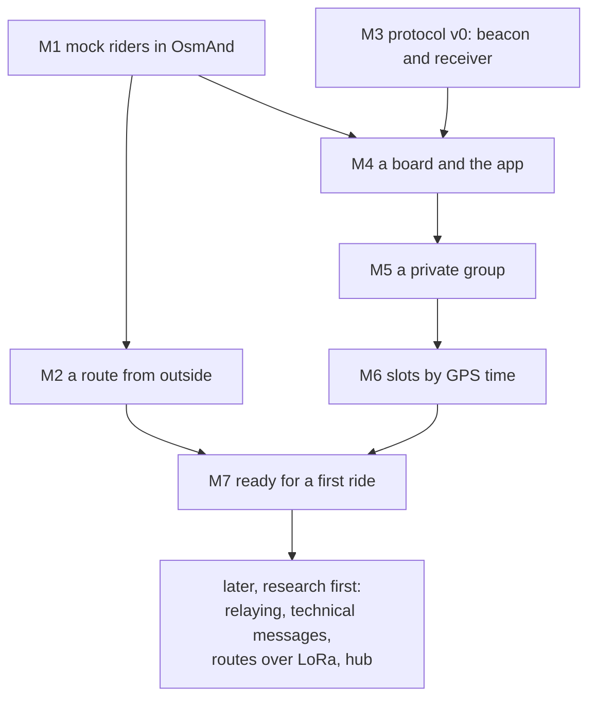

# Roadmap

Milestones in the order we build them. Each has a test that runs now, without boards, and a test
on hardware that waits for the owner's bench ([ARCHITECTURE](ARCHITECTURE.md), D8). Where a
decision is still open, the milestone names the ticket in [BACKLOG](BACKLOG.md) that settles it;
any ticket can become a GitHub issue as it stands.

Nothing is stable yet: a milestone may change the air format, the phone API or both, together with
everything that uses them (D3).

**Status:** planned · in progress · done, no hardware (its tests without boards pass) · done (its
hardware test passed too).

| | Milestone | App | Firmware | Status |
|---|---|---|---|---|
| M1 | Mock riders on the OsmAnd map | ✅ | | done, no hardware |
| M2 | A route from outside | ✅ | | planned |
| M3 | Protocol v0: a beacon and a receiver | | ✅ | planned |
| M4 | A board and the app | ✅ | ✅ | planned |
| M5 | A private group: invitation and encryption | ✅ | ✅ | planned |
| M6 | Slots by GPS time | | ✅ | planned |
| M7 | Ready for a first ride | ✅ | ✅ | planned |

## M1. Mock riders on the OsmAnd map

The map side first: it is the same whatever the radio ([05](05-osmand-integration.md)), and it can
be finished on an emulator.

- An app of our own in `android/`, on dmd2-lora-bridge's build setup.
- It connects to OsmAnd's AIDL service (OsmAnd, OsmAnd+ or OsmAnd~), notices when OsmAnd is
  missing or has not enabled us yet, and tells the rider where to enable it (on 5.4: Plugins).
- A mock source stands in for the board: three riders moving around a point, one of them going
  stale and one asking for help.
- One map layer, one point per rider: name and colour on the point; fix age, link age, speed and
  status in its details. Stale and help show on the point itself.
- Tapping a rider opens OsmAnd's menu with the details; its own NAVIGATION button routes to the
  rider.

**Test now:** JVM tests for the mock source and for turning a rider into a point. On the emulator,
with OsmAnd~ 5.4.10 from F-Droid: the riders appear and move, a tap shows the details, and
NAVIGATION routes to the rider. `android/emulator.sh` sets the emulator up, so the run repeats.
**Test on a device:** the same on the owner's phone, on OsmAnd's default engine.

**Result, 2026-10-22, on the emulator:** OsmAnd refused the app until it was switched on in
Plugins, and the app said where. Then three riders circled the map's centre: B turned red with
"B SOS", C went grey with its silence on the label, the details gave the times heard and of the
fix, and NAVIGATION routed 421 m to B on the Liechtenstein map. On OsmAnd's OpenGL engine, its
default, the riders blink at every update; on its Version 1 engine they do not (T-osmand-opengl).

## M2. A route from outside

Where a route from LoRa or from the hub will end up, tested before either exists.

- The app takes a GPX from outside: Android's share and "open with", which adb can drive too.
- It keeps the file under its SHA-256, the address a route will have over LoRa and on the hub
  ([06](06-own-protocol.md), Geometry and intent).
- It hands the file to OsmAnd: shown with `importGpx` and `showGpx`, navigated with `navigateGpx`
  only once the rider accepts, and never snapped to roads by default.
- "Received", "imported" and "navigating" stay separate states: OsmAnd's success only means a
  request was accepted ([05](05-osmand-integration.md)).

**Test now:** JVM tests for the file store. On the emulator: a GPX pushed with adb and shared to
the app shows in OsmAnd, and navigation starts once accepted.
**Test on a device:** a route shared from a messenger or a file manager.

Reversing a route and cutting it to a day's segment are T-route-intent.

## M3. Protocol v0: a beacon and a receiver

The first firmware: each board sends its own GNSS position and lists what it hears. Bench only,
since v0 is plaintext (D11).

- **[PROTOCOL](PROTOCOL.md) v0:**
  - the packet sketch of [06](06-own-protocol.md) without its tag, about 17 bytes;
  - one radio mode, SF7/250 at 869.525 MHz, with a sync word of our own; other modes are a line
    each until T-phy sets the defaults;
  - random access: a position every few seconds with jitter, and only with a fix;
  - the duty cycle enforced on the board, 10 % an hour.
- **The node core** (D7): the codec, the beacon's timing, the table of riders heard, the duty
  ledger.
- **GNSS:** one NMEA reader of our own for both boards (RMC and GGA: position, speed, course, time,
  fix quality) and the L76K's power pins. Zephyr's own GNSS driver stays unused, so both boards
  share one path.
- **From the bridge:** the platform layer, the SX1262 backend with the radio mode as a parameter
  instead of EBYTE's fixed one, the LED, the watchdog. A slot number is set from the console until
  M5.
- **Builds:** `heltec_v4` (ESP-IDF), `wio_tracker_l1` (Zephyr), `host`.

**Test now:** host tests for the codec (vectors), the NMEA reader (an L76K's multi-GNSS sentences),
the duty ledger and the beacon's timing. In the simulator, three nodes on scripted tracks each
list the other two with fresh fixes. Both board images build.
**Test on hardware:** the Heltec V4.3 with its GNSS kit and the Wio Tracker L1 Pro on a bench,
each listing the other on its console; then a few hundred metres apart outdoors.

## M4. A board and the app

- **Phone API v1** (D9): a status line with `proto=`; the riders heard; the board's own fix;
  setting the slot and the radio mode; forgetting the paired phone.
- **Firmware:** the bridge's BLE, with bonding and one owner, carries the phone API; the host build
  serves the same API over TCP.
- **App:** the bridge's BLE link on the new API: scanning, bonding, reconnecting, a foreground
  service; a TCP link in debug builds for simulated boards. Riders from the board replace the mock
  source; the board's own state shows in the app: fix, radio mode, duty used.

**Test now:** JVM tests for the phone API's parser. The emulator against the simulator: the app
connects to node 1 over TCP, and OsmAnd shows nodes 2 and 3 moving along their tracks.
**Test on hardware:** the owner's phone paired with each board in turn, with the other board's
rider on the map.

## M5. A private group: invitation and encryption

- **Group setup:** the organiser states the number of riders and how fresh positions must be; the
  radio mode, frame and slots follow ([06](06-own-protocol.md), Sizing), with a new key.
- **Invitation:** one string, as a QR code or a link ([01](01-goals.md), wishes). Each rider's app
  sets up its board from it, and one phone can set up several boards.
- **Authenticated encryption on air,** with a short group tag in clear and a replay check per slot.
  T-nonce, T-tag and T-length come first.

**Test now:** the cipher against RFC 3610's vectors; invitations round-trip; in the simulator, two
groups on one channel each see only their own riders, and forged or replayed packets are dropped
and counted; on the emulator, a simulated board set up from an invitation.
**Test on hardware:** two boards in one group and a third in another.

## M6. Slots by GPS time

The schedule of [06](06-own-protocol.md): frames numbered from an epoch in GPS time, one slot per
rider.

- Time from PPS where it is wired (the Heltec's GNSS kit), from NMEA elsewhere (the L1); the guard
  as a sum of named terms; silence once the timing uncertainty exceeds the guard; listening before
  transmitting after a restart or a late join.
- T-timing comes first, and T-join for riders who join late.

**Test now:** the simulator with clock models (offset, drift, jitter, a lost fix): 20 nodes and no
collisions inside the group, measured as [07](07-experiments.md) asks: the delivered share and the
age of the fix each map shows.
**Test on hardware:** E0 on each board, then three boards.

## M7. Ready for a first ride

- "Need help", acknowledged (T-help); "stopped" and "no GPS fix" as [01](01-goals.md) separates
  them.
- The EU profile only, with power and duty cycle enforced on the board, and the duty ledger
  exported (T-ledger; other countries are T-regions).
- Surviving a ride: the bridge's foreground service, reconnects and battery checks; a board that
  restarts rejoins (T-survive).

**Test now:** a ride replayed in the simulator from GPX logs: riders spreading out, stopping, one
asking for help. A soak run on the emulator.
**Test on hardware:** a short ride with two or three boards, measured as in [07](07-experiments.md).

## Later: research first

Each of these starts as a ticket and is settled on paper and in the simulator before any code:

- **Work out relaying** (T-relay): who relays, who owns a relay slot, the budget of a single rider
  bridging two bunches.
- **Technical messages** (T-control): routes as geometry plus intent, roster and mode changes,
  text; typed slots and their delivery.
- **Routes over LoRa** (T-route-lora), after M2 and M6.
- **A hub for slow data** (T-hub).
- **More of everything:** boards without GNSS (T-phone-gps), more boards (T-boards), more countries
  (T-regions), two speeds in one frame (T-two-speed).
