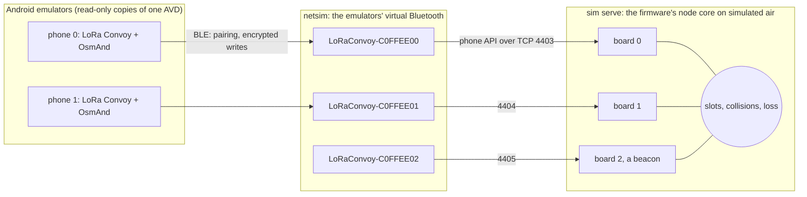

# The bench on one computer

Phones, boards, Bluetooth and the air between them, all simulated, so that the boards themselves
are left to test only what is theirs: their radios, GNSS receivers, Bluetooth stacks and power
([BENCH](../../docs/BENCH.md)).



- **`firmware/test/sim.c serve`** runs the boards: the firmware's own node core, with its
  encryption, slots, help and phone API, on simulated air.
- **`ble_board.py`** makes each board a Bluetooth peripheral in netsim, as `ble_nus.c` serves one:
  the Nordic UART Service, writes only over an encrypted link after Just Works pairing, one owner,
  FORGET, and bonds kept across restarts as a board keeps them in flash. It runs on Google's Bumble.
- **`bench.py`** starts it all and rides it: `up [PHONES]`, `ride`, `down`, one at a time. The phones are
  read-only copies of one AVD, which would share its Bluetooth keys and so look like one phone to
  a board; `up` gives each keys of its own, as a real phone has, and listens for every board by name
before it is done. A failed ride leaves each
  phone's screen at the failure beside the logs.

## What a ride checks

Each step names what ran in it as it will on a ride, and what stood in for the rest:

| Step | Runs as on a ride | Stands in |
|---|---|---|
| 1. Each phone finds its board over Bluetooth, pairs (Android's consent dialog accepted as a rider would), and talks to it encrypted. | the app's link (`BleBoardLink`), Android's Bluetooth and pairing | the board's Bluetooth: `ble_board.py`, a Python model of `ble_nus.c`, on Bumble; netsim's radio |
| 2. Phone 0 starts a group with the riders' names; each other phone joins with its own invitation; the last board rides alone, set up by hand (`GROUP`), as a beacon. | the app's invitations and `GROUP`; the firmware's phone API (`api.c`) and node core | the transport: TCP from `ble_board.py` to `sim serve` |
| 3. Every phone's board hears all the others. | the node core: keys, CCM, slots, replay checks | the radios and the air: `sim.c`'s slots, loss and collisions; time from a simulated GNSS |
| 4. Phone 1 calls for help, and every other board answers it. | the node core's calls and answers; the app's screen | as in 3 |
| 5. OsmAnd is stopped and started again, as a rider or an update does, and phone 0's map shows each other rider again: each one's colour in at least one of ten screenshots. The last frame is kept, for a look at the names. | the app's binding to OsmAnd; OsmAnd 5.4 on its Version 1 engine | — |
| 6. Board 0's Bluetooth restarts with its bond kept, and phone 0 comes back to it without pairing again. | Android's reconnecting, the app's link | the restart: only `ble_board.py` restarts, its bonds kept in a JSON file for flash; the node core runs on |
| 7. Board 0's Bluetooth restarts without its bonds, as its button held does, while phone 0 is away: the phone pairs again once the rider agrees (Android 15 does it by itself; on phones that do not, the app drops the stale bond after two refused sessions, BondHealth). | Android's and the app's handling of a stale bond | as in 6 |
| 8. Phone 1 forgets its board: the board drops the bond, says FORGOTTEN, and Android drops its own. | the app's `FORGET` and its dropping of Android's bond | the board's side: `ble_board.py` |
| 9. Phone 1, free now, tries phone 0's board, which turns it away: one owner per board. | the app's handling of a refusal | the board's refusal: `ble_board.py` |

Two rules follow from it:

- **A result names what ran and what stood in**, as above: a passed ride says nothing of the
  boards' own Bluetooth, nor of how the firmware comes back from a restart.
- **A fault is checked where it is.** A fix to `ble_nus.c`, or any of the firmware's C, is checked
  by a test that runs that C (the host tests, the boards), never only by a change to
  `ble_board.py`, which can only follow it.

How often OsmAnd shows the riders, rather than whether it does, is the OpenGL engine's blinking
(T-osmand-opengl): `bench.py map PHONE opengl|v1` sets the engine, and counts the frames with every
other rider, and with each, naming the engine and OsmAnd's version. What share is too little is not
settled yet. On a real phone the same count needs that phone's riders, and is not scripted.

## Running it

Once: `android/emulator.sh up`, `install` and `map`, and in OsmAnd, Plugins, switch LoRa Convoy on
(M1 in `emulator.sh`). Then:

```
python3 -I tools/bench/bench.py up 2      # about 2 minutes once built
python3 -I tools/bench/bench.py ride      # about 5 minutes; once per up, which starts the boards bond-free
python3 -I tools/bench/bench.py down
```

Bumble goes into `~/.cache/lora-convoy/bench-venv` from `requirements.txt` on the first `up`; logs,
bonds and screenshots go to `~/.cache/lora-convoy/bench`. Each phone takes about 2 GB of memory.

## What it does not check

The boards' own Bluetooth stacks (NimBLE on the Heltec, Zephyr's on the L1) and their storage of
bonds, the firmware's restart, their radios, GNSS and power; a phone asleep in a pocket. Those are
the bench with boards ([BENCH](../../docs/BENCH.md)).
