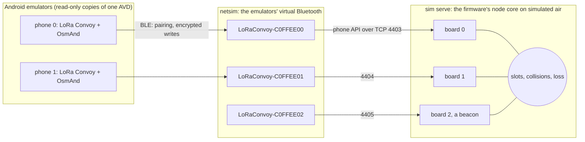

# The bench on one computer

Phones, boards, Bluetooth and the air between them, all simulated, so that the boards themselves
are left to test only what is theirs: their radios, GNSS receivers, Bluetooth stacks and power
([BENCH](../../docs/BENCH.md)).



- **`firmware/test/sim.c serve`** runs the boards: the firmware's own node core, with its
  encryption, slots, help and phone API, on simulated air.
- **`ble_board.py`** makes each board a Bluetooth peripheral in netsim, as `ble_nus.c` serves one:
  the Nordic UART Service, writes only over an encrypted link after Just Works pairing, one owner,
  FORGET, and bonds kept across restarts as a board keeps them in flash. It runs on Google's Bumble.
- **`bench.py`** starts it all and rides it: `up [PHONES]`, `ride`, `down`.

## What a ride checks

1. Each phone finds its board over Bluetooth, pairs (Android's consent dialog accepted as a rider
   would), and talks to it encrypted.
2. Phone 0 starts a group with the riders' names; each other phone joins with its own
   invitation; the last board rides alone, keyed by hand, as a beacon.
3. Every phone's board hears all the others.
4. Phone 1 calls for help, and every other board answers it.
5. Phone 0's OsmAnd shows every other rider: their colours are looked for in ten screenshots,
   and how many frames had them all measures the OpenGL engine's blinking (T-osmand-opengl). The
   last frame is kept, for a look at the names.
6. Phone 1 forgets its board: the board drops the bond, says FORGOTTEN, and Android drops its own.

## Running it

Once: `android/emulator.sh up`, `install` and `map`, and in OsmAnd, Plugins, switch LoRa Convoy on
(M1 in `emulator.sh`). Then:

```
python3 -I tools/bench/bench.py up 2      # about 2 minutes once built
python3 -I tools/bench/bench.py ride      # about 5 minutes; once per up, which starts the boards bond-free
python3 -I tools/bench/bench.py down
```

Bumble goes into `~/.cache/lora-convoy/bench-venv` from `requirements.txt` on the first `up`; logs,
bonds and screenshots go to `~/.cache/lora-convoy/bench`. Each phone takes about 2 GB of memory.

## What it does not check

The boards' own Bluetooth stacks (NimBLE on the Heltec, Zephyr's on the L1), their radios, GNSS
and power; a phone asleep in a pocket. Those are the bench with boards.
